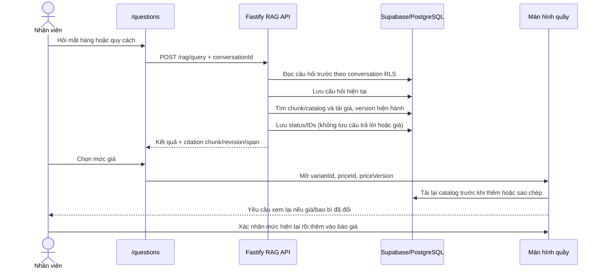
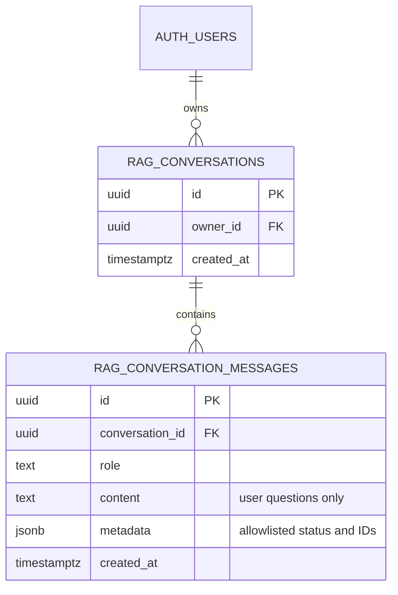

# RAG cho PriceApp

## Luồng dữ liệu

`Câu hỏi -> embedding truy vấn -> pgvector + tìm tên/quy cách -> lấy giá hiện hành bằng SQL -> LLM trả lời có nguồn`.

Chỉ văn bản OCR/bản chép **đã được chủ cửa hàng duyệt** và biến thể catalog có trạng thái `verified` được chunk và embedding. Giá không nằm trong nội dung chunk; `prices.amount`, ngưỡng số lượng, loại giá và hiệu lực luôn được truy vấn riêng từ PostgreSQL bằng ID sau khi tìm ra biến thể. Cập nhật giá vì vậy không cần tạo lại embedding.

## Cấu hình Supabase và mô hình

1. Áp dụng migration theo thứ tự trong `supabase/migrations` qua `npx supabase db push` hoặc SQL Editor. Các migration RAG thêm schema/vector, revision và thu hồi nguồn, generation/checkpoint; `202610090001_rag_page_chunk_review.sql` thêm cấu hình chunk theo trang và source span; `202610100001_rag_conversations.sql` thêm hội thoại RLS theo user; `202610110001_rag_citation_provenance.sql` trả revision/span từ RPC retrieval; `202610120001_rag_feedback.sql` lưu đánh giá có RLS; `202610130001_harden_price_rpc_guards.sql` làm role check đóng khi profile vắng mặt và từ chối `expected_version` thiếu; `202610130002_reject_nonfinite_price_values.sql` từ chối giá/số lượng `NaN` và vô cực. Chunk OCR cũ chưa có revision sẽ bị ẩn cho đến khi index lại.
2. Cài Ollama trên máy chạy backend, sau đó tải model embedding đa ngôn ngữ và model chat:

   ```sh
   ollama pull bge-m3
   ollama pull qwen2.5:3b
   ```

3. Sao chép `backend/.env.example` thành `backend/.env.local` và đặt biến RAG ở đó. Địa chỉ mặc định là `http://localhost:11434`. Nếu backend chạy trong container, dùng địa chỉ host/service mà container truy cập được. Frontend chỉ cần `NEXT_PUBLIC_API_BASE_URL` trỏ đến backend; không đưa provider key vào frontend.
4. Tạo/kiểm tra hồ sơ owner một lần trong Supabase SQL Editor bằng UUID của đúng Auth user. Ví dụ sau đây là thao tác quản trị có chủ ý; thay UUID bằng `auth.users.id` đã xác minh, không lấy UUID từ client:

   ```sql
   insert into public.profiles (id, role)
   values ('<AUTH_USER_UUID>', 'owner')
   on conflict (id) do update set role = excluded.role, updated_at = now();
   ```

   Không bật quyền tự sửa role qua client. Đăng nhập bằng tài khoản đó, mở `/rag-admin`, đối chiếu từng ảnh với bản chép trang, sửa OCR rồi bấm **Duyệt bản chép**. Dữ liệu trang chưa duyệt không được index. Tài khoản thiếu hồ sơ được xem như `viewer` trong RPC giá/catalog.
5. Bấm **Kiểm tra kết nối** ở `/rag-admin` để xem riêng trạng thái Supabase, embedding 1.024 chiều và chat model. Chỉ sau khi cả ba sẵn sàng mới bấm **Tạo lại embedding**. Pipeline lưu chunk kèm trang nguồn, revision, hash, chunker version và model artifact. Nếu bị gián đoạn, mở lại trang và bấm **Chạy tiếp** để tiếp tục từ checkpoint.
6. Mở `/questions`, hỏi thử; kết quả kết hợp semantic retrieval, PostgreSQL full-text/trigram catalog search, thuộc tính nói rõ trong câu hỏi, truy vấn giá SQL, LLM và citation tới chunk/revision/span. Nếu chọn một mức giá, nút **Chọn mức này** mở đúng biến thể ở màn hình bán hàng. App tải lại bảng giá khi thêm vào giỏ và khi sao chép báo giá; nếu giá hoặc bao bì đổi, cần xem lại rồi xác nhận.
7. Có thể hỏi tiếp trong cùng cuộc trao đổi bằng câu như “còn loại 10 ly?”. Hội thoại giữ câu hỏi và metadata trạng thái/ID dưới RLS; câu trả lời cũ và số tiền không được dùng làm nguồn giá mới. Chỉ tên mặt hàng từ câu trước được nối khi câu follow-up thiếu tên; quy cách và loại giá phải được nêu lại.
8. Nhân viên có thể đánh giá câu trả lời và chọn lý do cố định; `/rag-admin` tổng hợp phản hồi và xuất CSV. Bảng này giúp tìm lỗi cần xem, nhưng không thay thế người duyệt test labels hoặc kiểm tra các câu trả lời về tiền.

## Hội thoại và chuyển sang báo giá





Đánh giá offline bằng các nhãn đã được người phụ trách duyệt và quan sát đã ghi nhận; runner không tự tạo nhãn hoặc benchmark:

```powershell
cd backend
npx tsx src/rag/evaluation-runner.ts --cases <cases.json> --observations <observations.json> --output <report.json>
```

Muốn tách tập tune/test thì thêm `--seed <seed-cố-định> --tune-fraction <0..1>`. Đọc [hướng dẫn định dạng và báo cáo](backend/docs/RAG_EVALUATION.md); không công bố điểm nếu chưa có test set đã adjudicate.

Chạy cả hai workspace bằng `npm run dev` từ root; backend mặc định ở port `4000`, frontend ở `3000`. Health API là `/api/v1/health`. Cấu hình origin web chính xác trong `FRONTEND_ORIGINS`. Xem [workspace runbook](docs/workspace-runbook.md) về deploy tách rời, đăng nhập, CI và E2E test an toàn.

Có thể dùng API tương thích OpenAI thay cho Ollama bằng `RAG_AI_PROVIDER=openai-compatible`, đặt `RAG_AI_BASE_URL` đến API có `/embeddings` và `/chat/completions`, đặt `RAG_AI_API_KEY`, `RAG_EMBEDDING_MODEL` và `RAG_CHAT_MODEL`. Model embedding phải trả đúng 1.024 số cho mỗi văn bản để khớp migration.

## Phạm vi và giới hạn hiện tại

- App chưa tự OCR ảnh. Màn hình `/rag-admin` cung cấp quy trình nhập/soát bản chép bằng tay cho 13 trang để đảm bảo nội dung được duyệt trước khi embedding.
- Catalog chỉ index các biến thể `verified`; những mặt hàng chưa duyệt không được xem là bằng chứng chuẩn.
- Mỗi câu trả lời trả về số chunk vector, số kết quả lexical, trang nguồn và giá chính xác lấy từ bảng SQL.
- Thay nội dung OCR hoặc catalog đã xác minh thì chạy lại index. Chỉ sửa giá thì không cần.
- Lưu bản nháp làm chunk OCR của revision cũ biến mất ngay. **Thu hồi cả trang** ẩn mọi chunk OCR/catalog gắn trang đó; biến thể inactive/unverified cũng không còn dùng làm chunk tìm kiếm. Service worker giữ HTML shell chung của `/` và asset build để mở POS đọc snapshot sau khi tải lại khi mất mạng; không lưu API hay dữ liệu theo phiên vào Cache Storage. Đăng xuất xóa snapshot và cache.
- Bộ [20 câu hỏi L1](docs/RAG_L1_CASES.md) là ứng viên cho vòng thử đầu tiên; cần đối chiếu trang nguồn và khóa đáp án trước khi tính độ đúng.

## Đề xuất đánh giá đồ án

Lập tập câu hỏi có đáp án chuẩn gồm tên có dấu/không dấu, biệt danh, quy cách gần giống nhau, hỏi giá sỉ/lẻ, hỏi trang nguồn và câu không có trong dữ liệu. So sánh keyword-only với hybrid RAG bằng Recall@k/MRR cho retrieval, độ đúng giá và citation accuracy cho câu trả lời, cùng latency và số token/chi phí của LLM. Giữ nguyên tập câu hỏi khi thay model hoặc cách chunk để kết quả so sánh được.
