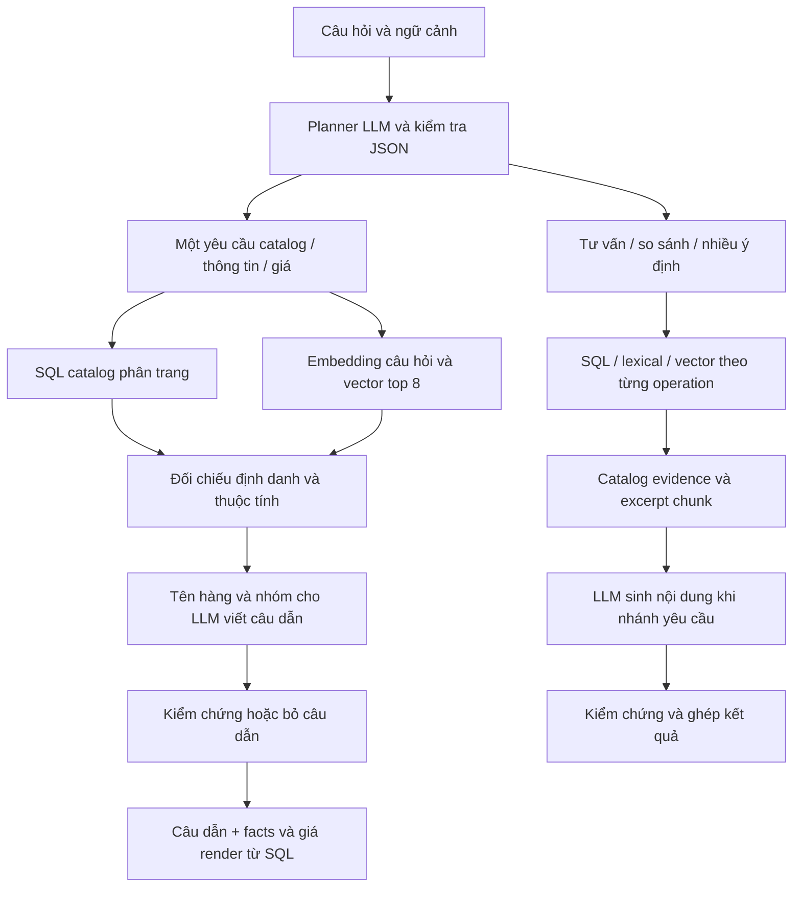

# Kiểm tra RAG độc lập bằng ba subagent

Ngày: 2026-10-19. Phạm vi: mã nguồn hiện tại sau bản sửa model-first và bằng chứng kiểm thử đã lưu.

Ba nhánh kiểm tra độc lập:

1. `audit_rag_architecture`: phân loại kiến trúc, retrieval, augmentation, generation và các đường dự phòng.
2. `audit_rag_preprocessing`: corpus, tiền xử lý, chunking, định danh, nguồn và freshness.
3. `audit_embedding_evaluation`: cấu hình embedding, evaluator hiện có và quy trình benchmark.

Audit chỉ đọc mã/tài liệu, đọc log đã có và chạy ví dụ hàm cục bộ. Không sửa implementation, database, migration, cấu hình model hoặc tiến trình ứng dụng. Báo cáo này là phần tổng hợp được thêm vào repo. Không kiểm tra lại trạng thái migration/RLS trên Supabase đang triển khai.

## 1. Kết luận

**Có thành phần RAG thực sự, nhưng chưa đủ bằng chứng để khẳng định hệ thống đã đạt chất lượng RAG hoặc embedding đã được lựa chọn bằng thực nghiệm.** Tên mô tả phù hợp là:

> Trợ lý tra cứu catalog với planner LLM, truy xuất SQL kết hợp dense retrieval, sinh ngôn ngữ có kiểm chứng và hiển thị số liệu trực tiếp từ SQL.

Các bài RAG/RAGAS cung cấp cơ sở đánh giá retrieval và generation, không phải chứng nhận rằng cài embedding và vượt unit test là đã đủ chất lượng. Bản sửa trước giải quyết các lỗi tra quy cách đã tái hiện; không phải bằng chứng mọi nhánh đã trở thành LLM đọc tài liệu và tổng hợp câu trả lời.

| Thành phần | Kết quả kiểm tra |
|---|---|
| Corpus ngoài model, có embedding và truy xuất thật | Có |
| Planner gọi model trước ở entry point thông thường | Có; có đường fallback và reference riêng |
| LLM nhận đầy đủ nội dung truy xuất ở mọi câu hỏi | Không; nhánh catalog chỉ đưa tên hàng/nhóm vào model viết câu dẫn |
| Giá, quy cách, đóng gói chính xác từ database | Có cơ chế giữ số liệu SQL; cần tiếp tục kiểm thử định danh và lựa chọn dòng đúng |
| Một cơ chế hybrid/ranking thống nhất | Chưa; nhánh catalog mới và operation cũ khác nhau |
| Bằng chứng cập nhật theo phiên bản nội dung | Một phần; eligibility/generation có, kiểm content revision khi query còn thiếu |
| Đánh giá embedding trên dữ liệu miền có nhãn | Chưa có bằng chứng |

Không gọi đây là mô hình được fine-tune end-to-end, RAG-Token/RAG-Sequence của bài gốc, hoặc agent tự lập kế hoạch và gọi công cụ nhiều vòng. Code hiện là orchestration tại thời điểm suy luận.

## 2. Mô hình đang chạy như thế nào?



### Nhánh catalog mặc định

`rag-query.service.ts:883–885` chuyển một yêu cầu model hợp lệ sang `queryCatalogRag`. SQL và dense retrieval chạy song song (`catalog-rag.service.ts:61–103`). Tuy nhiên:

- Khi SQL có rows, vector chủ yếu xếp lại các kết quả SQL đã qua bộ lọc.
- Chỉ khi tập SQL rỗng mới dùng seed vector để mở rộng nhóm sản phẩm.
- Nhánh này không gọi `rank.ts` và không thực hiện RRF giữa hai tập ứng viên đầy đủ.
- Packet có `documents: []`; payload generation chỉ chứa `productName` và `category` (`catalog-rag.service.ts:136–152`). Model không được đọc đoạn chunk, giá, quy cách hay mô tả đầy đủ để viết phần facts.
- Phần quy cách, đóng gói, thuộc tính và giá được ứng dụng render từ SQL (`catalog-rag.service.ts:157–176`). Đây là lựa chọn hữu ích để giữ số liệu chính xác, nhưng phải mô tả đúng vai trò giới hạn của generation.

Vì vậy, gọi nhánh này là structured-catalog retrieval kết hợp LLM sẽ chính xác hơn khẳng định LLM đang đọc tài liệu nguồn để trả lời toàn bộ.

### Nhánh operation còn lại

`queryRagOperation` có các đường SQL xác định cho list, facts, giá cụ thể và reference. Nhánh tư vấn/so sánh không hỏi giá có lexical và vector, dùng RRF trong `rank.ts:1–12`, sau đó đưa excerpt cho generator (`rag-query.service.ts:733–795`). Multi-intent được chia operation rồi ghép, nên không mặc nhiên có toàn bộ xử lý quy cách mới của nhánh catalog đơn.

Các excerpt hiện được index từ summary catalog SQL. Tên kiểu evidence là `document` không đồng nghĩa đang đọc OCR nguyên văn của ảnh. Corpus hiện hành trong code là catalog-only.

## 3. Xử lý trước khi đưa vào embedding/model

### Offline: chuẩn bị tri thức

```text
product/category active + variant verified
→ tạo summary riêng cho từng variant
→ NFC, chuẩn hóa xuống dòng, bỏ ký tự NUL/dòng trống
→ chunk tối đa 1.100 ký tự, overlap 160 ký tự
→ embedding dense 1.024 chiều
→ lưu chunk + metadata + content hash + fingerprint
→ staging theo generation → publish
```

Summary gồm tên hàng, mô tả, aliases, quy cách gốc, diễn giải quy cách, search_text, thuộc tính và đóng gói; không đưa giá vào embedding (`rag-index.service.ts:52–83`). Giá được đọc riêng từ SQL tại lúc trả lời.

Điểm tốt:

- Chunk theo variant, hạn chế trộn hai mặt hàng.
- Giữ dấu tiếng Việt bằng NFC; so khớp tên có thêm bước bỏ dấu riêng.
- Hash/fingerprint, batch 16, reuse vector không đổi và publish generation hỗ trợ reindex có kiểm soát (`rag-index.service.ts:88–112`).
- Public/staff có RPC riêng; mã nguồn lọc active/verified và hạn chế dealer cho public.

Giới hạn:

- 1.100/160 là **ký tự**, không phải token hay thông số đã được benchmark tối ưu.
- Overlap có thể cắt giữa từ; chunk tiếp theo không luôn nhắc lại tên sản phẩm cha.
- Index để source revision/span null, chọn một trang liên kết làm metadata. Citation là provenance của catalog, chưa phải đoạn nguyên văn từ đúng vùng ảnh.
- Repo có migration retire OCR và xóa dữ liệu OCR (`202610180009`, `202610180012`); audit không xác nhận lại việc áp dụng chúng trên DB live.

### Online: hiểu và truy xuất câu hỏi

```text
câu hỏi gốc + follow-up
→ planner LLM: intent, tên, specs, material, điều kiện
→ kiểm schema/confidence, chuẩn hóa optional blanks
→ đối chiếu thêm định danh/kích thước literal
→ chuẩn hóa kích thước khi tìm kiếm
→ SQL + vector, quyền truy cập, hard filters
→ evidence giới hạn theo nhánh
→ generation → validation → facts/giá SQL
```

Các biến đổi kích thước chỉ phục vụ tìm kiếm; không ghi ngược quy cách hay số tiền gốc. Tuy nhiên những parser/guard chạy sau planner vẫn có thể làm mất thông tin dù model hiểu đúng.

## 4. Phát hiện cần ưu tiên

### P1 — tiền xử lý làm mất tên hàng và mã

Đã tái hiện trực tiếp tại hàm, không gọi DB/provider:

| Input | Thông tin bị mất |
|---|---|
| `giá co 21` | tên/spec rỗng: `co` bị coi như từ hội thoại `có`, số 21 không được giữ thành spec |
| `giá co L 21` | tên/spec rỗng, `L` bị hiểu là đơn vị |
| `giá bu lông M 8` | chỉ còn tên `bu`; `lông` bị đồng nhất với stop word `long`, `M` bị hiểu là đơn vị, số 8 mất |
| `gia keo AB-123` | còn tên `keo`, `AB`; phần số không thành spec |

`query-understanding.ts:114–125,165–169` bỏ dấu trước khi xét stop words và mask đơn vị. Trong ví dụ riêng, candidate `Keo / AB-999` vẫn vượt `matchesNamedCandidate(...,"keo AB")` và `matchesExplicitQuery(...,"AB-123")`. Đây là bằng chứng lỗi matcher, **chưa phải xác nhận API live đã báo giá nhầm mã đó**.

Nhánh catalog còn có clarify sớm khi literal name rỗng (`catalog-rag.service.ts:41–47`). Vì vậy gọi planner LLM trước chưa tự loại bỏ tính dễ vỡ của xử lý regex phía sau.

### P1 — metric hiện tại có thể tạo kết luận quá tốt

- `evaluation.ts:178–184` gọi `.some()` trên top 5 rồi tính tỷ lệ. Trường tên `recallAt5` hiện là **HitRate@5**. Có 10 relevant variants nhưng tìm đúng 1 thì metric hiện tại chấm 1, trong khi set Recall@5 là 0,1.
- `evaluation.ts:155–157` chỉ chấm adjudicated case có observation. Timeout/mất observation không vào mẫu số. Runner có đếm thiếu riêng nhưng người đọc có thể chỉ nhìn điểm accuracy.
- `perIntent.answerAccuracy` chỉ kiểm answer-versus-abstain (`evaluation.ts:193–195`), không đo trả đúng hàng/giá/nội dung. Cần đổi tên hoặc tính đúng trước khi dùng trong báo cáo môn học.

### P1/P2 — freshness, provenance và model artifact

- `rag_chunk_is_current` kiểm variant/product/category còn hợp lệ, không đối chiếu revision/content hash (`202610180009_catalog_only_rag.sql:65–73`). Trước khi worker reindex xong, summary/excerpt cũ vẫn có thể được dùng; giá SQL mới không chứng minh mô tả chunk cũng mới.
- Index để revision/span null và hash corpus không gắn đầy đủ nguồn trang. Gỡ/sửa liên kết trang có thể chưa làm citation metadata đổi ngay.
- Fingerprint artifact có trong indexing; query match RPC chủ yếu so tên model và dimensions. Đổi artifact dưới cùng tag có thể gây lệch không gian vector trong khoảng chuyển đổi. Đây là rủi ro từ mã nguồn, chưa tái hiện live trong audit.

### P2 — thuộc tính và kiểm chứng nội dung

- Filter chất liệu suy từ tên/spec, không sử dụng trực tiếp `attributes.material`. Ví dụ vật liệu inox chỉ nằm trong attributes có thể bị loại sai (`candidate-filters.ts:52–63`).
- Whitelist từ/kiểm sự xuất hiện từ khóa chưa tương đương kiểm chứng entailment: chưa đảm bảo phân biệt phủ định, tương thích hay mức tải.
- Cần log riêng generation accepted/rejected/provider fallback. Log smoke có hai lần chat/câu nhưng một trong năm câu sinh bị loại; gọi model không đồng nghĩa mọi câu văn model đều được dùng.

Không tìm thấy bằng chứng đủ để tuyên bố lỗi P0 trong phạm vi audit. Các rủi ro freshness/provenance cần test tích hợp staging trước khi kết luận xảy ra trên live.

## 5. Embedding hiện tại và mức bằng chứng

| Thuộc tính | Hiện trạng |
|---|---|
| Embedding | BGE-M3 qua Ollama `/api/embed`, vector dense 1.024 chiều |
| Lưu/tìm kiếm | pgvector, cosine, HNSW, active generation |
| Top-k | repository yêu cầu 8 |
| Ngưỡng | similarity tối thiểu 0,2 tại service, chưa thấy bằng chứng đã tune trên qrels miền |
| Sparse/multi-vector của BGE-M3 | Không thấy được dùng; lexical là truy vấn SQL riêng |
| Reranker học máy | Không thấy trong các đường đã kiểm tra |

BGE-M3 hỗ trợ dense/sparse/multi-vector, nhưng ứng dụng chỉ dùng dense; không nên ghi app tận dụng cả ba vì model có khả năng đó. Model card cũng không chứng minh model là tốt nhất cho dữ liệu vật tư tiếng Việt của app.

Bằng chứng hiện có:

- 17 case trong `backend/testdata/rag-assistant-cases.json`, **tất cả là candidate**, chưa có nhãn adjudicated.
- `sourceId` đang gom 10 case vào `candidate-catalog`, 6 vào `candidate-document`, 1 vào `assistant-policy`; quá chung để coi là nhiều nguồn độc lập khi split.
- Evaluator đọc cases/observations đã có để tính report; không tự chạy retriever hoặc model.
- Smoke 2026-10-18 đi fast path không dùng vector/model.
- Smoke 2026-10-19 có 5 câu API thật, dùng BGE-M3 và chat thật, xác nhận hoạt động và lỗi đã sửa. Không có qrels/đối chứng/held-out test để suy ra chất lượng embedding.
- 390 test backend, 84 frontend và build/lint/typecheck đạt ở lượt sửa trước là bằng chứng phần mềm, **không phải điểm benchmark embedding/RAG**. Một số test chủ đích kiểm operation SQL dự phòng thay vì entry point model-first.

## 6. Cách đánh giá embedding cho dự án này

### Bước 1 — khóa dữ liệu và điều kiện thí nghiệm

Lưu snapshot catalog, variant/chunk IDs, quyền public/staff, version giá, corpus hash; pin artifact/quantization, chunker, preprocessing, top-k, threshold, fusion và phần cứng. Chỉ so model khi các yếu tố còn lại tương đương.

### Bước 2 — tạo tập câu hỏi có nhãn

Đề xuất pilot 200–300 câu, **không phải số lượng chuẩn bắt buộc**. Bao phủ cách hỏi thật, alias, không dấu/lỗi gõ, mã có dấu nối, đơn vị tương đương, họ hàng khác nhau cùng kích thước, vật liệu, đóng gói, giá sỉ/lẻ, liệt kê, ngữ cảnh, hàng/cỡ không tồn tại và tư vấn thiếu căn cứ.

Hai người hiểu catalog gán nhãn và giải quyết bất đồng. Mỗi câu cần các variant/chunk liên quan, mức liên quan 0/1/2, answer/clarify/abstain, facts bắt buộc và giá/gói/tầng giá/đơn vị/citation khi áp dụng. Tắc kê và bulong cùng cỡ là hard negative, không tự coi tương đương ngữ nghĩa là đúng hàng.

Gộp các paraphrase/cùng question family vào cùng split; tune threshold trên tune set rồi khóa test. Corpus vẫn chứa tài liệu cần tìm của test; giữ kín câu hỏi/nhãn test, không xóa đáp án khỏi corpus rồi gọi đó là đánh giá retriever.

### Bước 3 — đo retrieval riêng, trước generation

So ít nhất:

1. SQL lexical hiện tại.
2. BGE-M3 dense-only.
3. Nhánh SQL+dense hiện tại.
4. Thí nghiệm union lexical+dense với RRF.
5. Hybrid + reranker nếu có triển khai sau này.

Đây là các đối chứng/thí nghiệm đề xuất; không khẳng định nhánh catalog hiện đã làm RRF hay có reranker.

Với `Gq` là tập kết quả đúng và `Rq,k` là top k đã loại trùng:

```text
HitRate@k(q) = 1 nếu Rq,k giao Gq khác rỗng; ngược lại 0
Recall@k(q)  = |Rq,k giao Gq| / |Gq|
MRR@k       = trung bình 1 / hạng kết quả đúng đầu tiên, không có thì 0
```

Báo thêm nDCG@k cho nhãn phân mức, precision của context thực đưa vào LLM; đo riêng cấp variant và cấp chunk. Câu không có đáp án không chia Recall cho 0: chấm khả năng abstain/clarify riêng. Liệt kê hơn 8 variants phải có list recall/completeness của SQL, không dùng top 8 vector để chứng minh đủ danh sách.

### Bước 4 — đo chất lượng đầu ra

Giữ planner/chat cố định khi so embedding. Đo đúng hàng/quy cách, chọn đúng price row/gói/tầng giá/đơn vị và amount khớp nguyên SQL; độ đầy đủ danh sách; citation hỗ trợ claim; groundedness theo factual claim; tư vấn không căn cứ; answer coverage; abstention đúng; generation rejection/fallback rate.

RAGAS/LLM judge có thể hỗ trợ, cần đối chiếu nhãn người. Không dùng judge thay phép so sánh số tiền/ID/đơn vị xác định.

### Bước 5 — hiệu năng và lựa chọn model

Đo p50/p95 riêng embedding, SQL/vector, rerank, planner, generation và end-to-end; tách cold/warm, cố định concurrency, ghi RAM/VRAM, thời gian index và dung lượng. Khoảng 2–3 giây của 5 câu smoke chưa phải SLA hoặc phân bố latency đáng tin.

So trên cùng câu hỏi, có khoảng tin cậy theo group và phân tích riêng nhóm mã hàng/kích thước/không dấu/không có đáp án. Chọn threshold sau tune; cosine 0,2 không phải xác suất đúng và không dùng nguyên cho mọi model.

Mỗi model mới phải encode lại cả corpus và queries, đúng prefix/pooling/normalization của model. Không dùng corpus vector cũ dù dimensions giống; không cắt/pad vector để ép vừa schema. Model khác chiều cần index/schema benchmark riêng hoặc migration mới. Pin artifact hoặc kiểm fingerprint query với active index khi chuyển model.

## 7. Thứ tự công việc nên làm tiếp

1. Giữ nguyên định danh/mã/số trong preprocessing; bổ sung acceptance cases `co 21`, `co L 21`, `bu lông M 8`, `AB-123`, vật liệu trong attributes và các nhánh multi-intent. Không tiếp tục sửa theo từng câu hỏi đặc biệt.
2. Xác định rõ hợp đồng evidence: model được giải thích facts nào, dữ liệu SQL nào render xác định, trace generation/fallback và nguồn nào thực sự hỗ trợ mỗi claim.
3. Kiểm freshness theo version/hash và nguồn trang; test sửa catalog/gỡ nguồn trong lúc worker chưa publish; bảo vệ artifact query/index.
4. Sửa metric, adjudicate tập pilot và chạy đối chứng lexical/dense/hybrid trước khi chọn embedding hoặc tuyên bố chất lượng.

Các việc trên là đề xuất từ audit; chưa triển khai trong lượt kiểm tra này.

## Nguồn kỹ thuật đối chiếu

- [Lewis et al., RAG, NeurIPS 2020](https://papers.nips.cc/paper/2020/hash/6b493230205f780e1bc26945df7481e5-Abstract.html): cơ sở retrieval kết hợp generation.
- [BAAI BGE-M3 model card](https://huggingface.co/BAAI/bge-m3): capabilities, dimensions và cách dùng các đầu ra.
- [MTEB](https://arxiv.org/abs/2210.07316): đánh giá embedding trên nhiều tác vụ, không suy một model tối ưu mọi miền.
- [BEIR implementation](https://github.com/beir-cellar/beir): corpus/query/qrels và metric retrieval.
- [RAGAS, EACL 2024](https://aclanthology.org/2024.eacl-demo.16/): tách đánh giá context truy xuất, độ trung thành với bằng chứng và chất lượng generation.

Các ngưỡng, cỡ pilot và thứ tự ưu tiên trong báo cáo là đề xuất cho dự án này, không phải chứng nhận hay tiêu chuẩn chung do các nguồn trên đặt ra.
